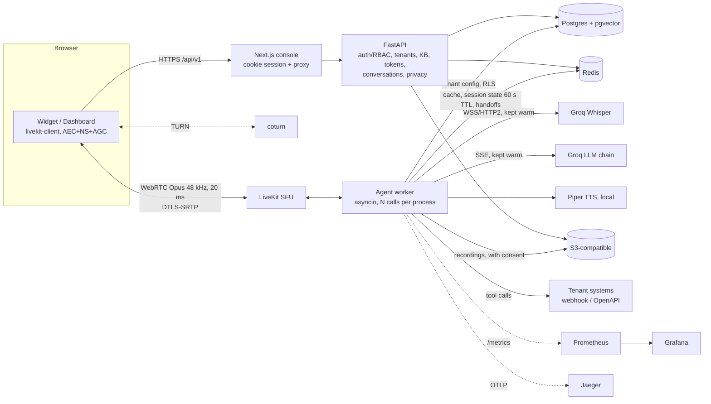
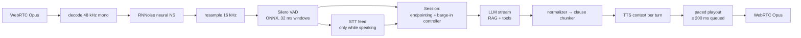

# Voxa — multi-tenant real-time voice support agents

Any organization (a *tenant*) gets its own voice support agent: its own persona, voice, knowledge base, tools and
escalation rules. Customers talk to it from a browser widget (full-duplex WebRTC); the conversation streams end to end
(speech-to-text → LLM tokens → text-to-speech chunks → audio frames) so it feels like talking to a fast, attentive person.

* **Measured results** (latency, interruptions, noise, echo, load, evals): [`docs/reports/latency_interruption.md`](docs/reports/latency_interruption.md)
  — generated by the test harness, with the pass/fail verdict against the requirements. Read it before trusting any claim here.
* Architecture detail: [`docs/ARCHITECTURE.md`](docs/ARCHITECTURE.md) · state machine: [`docs/STATE_MACHINE.md`](docs/STATE_MACHINE.md) ·
  turn-taking tuning: [`docs/TUNING.md`](docs/TUNING.md) · adding a tenant: [`docs/TENANTS.md`](docs/TENANTS.md)

## Architecture



### Per-call audio pipeline



Every response carries a `generation_id`; anything stale is dropped at each stage. Outbound audio is paced in real time
and never queued more than ~200 ms ahead, so a flush is instant. Mic ingestion never pauses while the agent talks.

## Run it locally

Prerequisites: Docker (≥ 8 GB for the VM), a free [Groq](https://console.groq.com) API key. Nothing else is required.

```bash
cp .env.example .env            # then set GROQ_API_KEY=...
cd infra
docker compose up --build       # first build downloads models (~1.5 GB); starts everything
docker compose run --rm seed    # seeds the sample tenant "Acme Electronics" (KB + two tools + users)
```

| What | Where |
|---|---|
| Console (dashboard) | http://localhost:3000 — `admin@acme.test` / `acme-admin-pass-123` (also `editor@…`, `viewer@…`) |
| API | http://localhost:8000 (`/docs` for OpenAPI) |
| Grafana (dashboard "Voxa — voice agent") | http://localhost:3001 |
| Prometheus · Jaeger | http://localhost:9090 · http://localhost:16686 |
| Sample tenant's backend (order lookup, tickets) | http://localhost:8100 |

Open **Test call** in the console and talk: *"What's your return policy for headphones?"*, *"Where is my order A C 4 8 2 1 3?"*,
*"My earbuds are broken, please open a ticket."* (the agent reads the details back and waits for a yes), *"I want to talk to a person."*
Interrupt it mid-sentence. The latency overlay shows each turn's breakdown.

Without a Groq key the stack still starts: the agent falls back to a rule-based **stand-in** model (not a real LLM) and local
Whisper, which is enough to exercise the pipeline but not to judge conversation quality or latency.

### Embed the widget

```html
<script src="https://YOUR-CONSOLE/widget.js" data-key="wk_…" data-title="Ask Ava" data-color="#0f766e" async></script>
```

Get the key and allowed-origin list from **Website widget** in the console. The key is publishable; abuse is bounded by the
origin allow-list and server-side rate limits.

## Configuration (environment variables)

| Variable | Purpose |
|---|---|
| `GROQ_API_KEY` | LLM (`GROQ_MODELS`, default `qwen/qwen3.8-27b,openai/gpt-oss-20b,openai/gpt-oss-120b` as a fallback chain) and Whisper STT finals |
| `LLM_PROVIDER` | `groq` (default with a key) · `mock` (fixed reply, used by the test harness) · `rulebased` (key-less stand-in) |
| `STT_PROVIDER` | `groq` (cloud finals + local interims) · `local` (faster-whisper) · `stub` (load tests only) |
| `LIVEKIT_URL` / `LIVEKIT_PUBLIC_URL` / `LIVEKIT_API_KEY` / `LIVEKIT_API_SECRET` | SFU (secret ≥ 32 chars) |
| `DATABASE_URL` (app role, RLS-confined) · `DATABASE_ADMIN_URL` (migrations, operator tasks) · `REDIS_URL` | state |
| `VOXA_KMS_KEY` | Fernet key encrypting tenant secrets at rest — use a KMS-managed key in production |
| `JWT_SECRET` · `ADMIN_TOKEN` | dashboard sessions · platform-operator API |
| `SIGNUP_ENABLED` | self-serve signup in the console (`1`/`0`) |
| `TOOL_ALLOW_PRIVATE` | **dev only**: let tools call private addresses (the sample tenant calls a container). Keep `0` in production (SSRF guard) |
| `S3_ENDPOINT` `S3_PUBLIC_ENDPOINT` `S3_BUCKET` `S3_ACCESS_KEY` `S3_SECRET_KEY` | recordings (SeaweedFS in compose) |
| `JOB_EXECUTOR` (`process`/`thread`) · `MAX_SESSIONS` · `DRAIN_TIMEOUT_S` | agent capacity and graceful drain |
| `OTEL_EXPORTER_OTLP_ENDPOINT` | enables traces |
| `RETENTION_INTERVAL_S` | retention sweep interval (compose); the Helm chart uses a CronJob |

## Add a tenant

See [`docs/TENANTS.md`](docs/TENANTS.md). In short: validate a YAML config (`samples/acme/tenant.yaml` is the reference),
`POST /v1/admin/tenants`, store tool secrets, upload knowledge, mint calls. Or let the owner self-serve through **Create an agent**
in the console (onboarding wizard: agent → knowledge → voice → turn-taking → live test call).

## Turn-taking tuning guide

Everything is per tenant (Agent → Turn-taking in the console, or `turn:` in the config). Full guide: [`docs/TUNING.md`](docs/TUNING.md).

| Symptom | Knob |
|---|---|
| Agent talks over people who pause | raise `endpoint_complete_ms` (default 300) / `endpoint_incomplete_ms` (1500) |
| Feels slow to answer | lower `endpoint_complete_ms` (≥ 250 recommended); keep preemptive generation on |
| Stops for noises | raise `vad_threshold_speaking` (0.65), `stage1_min_speech_ms` (160) |
| Interrupting feels sluggish | lower `stage1_min_speech_ms` (more soft-pause glitches) |
| Speaker echo pauses it | `echo_gate_ratio` (0.05); make sure browser AEC is on (the widget requests it) |
| TV / crowd interrupts it | `near_field_gate_db` (9); a real fix is background-voice cancellation (Krisp BVC), not included |
| Backchannels interrupt | `extra_backchannels`, `languages` |

## Testing

```bash
# unit + integration (needs the compose Postgres/Redis for the integration tests)
python -m pytest tests/unit tests/integration
# browser end-to-end: dashboard, widget on a third-party origin, fake microphone (Chromium)
cd web && npm ci && npx playwright install chromium && npx playwright test
# real-WebRTC scenario harness (stack running; see tests/audio_harness/*.py)
PYTHONPATH=tests/audio_harness python tests/audio_harness/acme_e2e.py all
PYTHONPATH=tests/audio_harness python tests/audio_harness/matrix.py robustness --reps 8    # run the agent with LLM_PROVIDER=mock
PYTHONPATH=tests/audio_harness python tests/audio_harness/matrix.py latency --n 30         # real LLM + STT
python tests/load/load_test.py --steps 10,25,50,100                                        # agent: STT_PROVIDER=stub LLM_PROVIDER=mock JOB_EXECUTOR=thread
python tests/evals/run_evals.py                                                            # LLM-simulated callers + LLM judge
python tests/perf/perf.py report && python tests/perf/perf.py gate                         # report + CI gate (exit 1 on a miss)
```

Regenerate audio fixtures with `python tests/fixtures/make_fixtures.py [--noise]` (macOS `say`).

## Deployment

* **Compose** (above) for local development and single-node demos.
* **Kubernetes**: `helm upgrade --install voxa infra/helm/voxa -f my-values.yaml`. The chart deploys the API, console, agent workers,
  coturn, a retention CronJob, an HPA, a PDB and the Grafana dashboard. LiveKit, Postgres+pgvector, Redis and S3 are expected to exist
  (managed services or their own charts). **The chart is linted and rendered in CI but has not been applied to a live cluster.**
* **Deploys don't drop calls**: on SIGTERM a worker stops accepting calls and lets live calls finish (`drainTimeoutSeconds`);
  `maxUnavailable: 0` rolling updates; scale-down is slow by design. Autoscaling uses `voxa_active_sessions` (needs prometheus-adapter) or CPU.
* **Co-location**: run LiveKit, the agent and the STT/LLM endpoints in the same region; the voice-to-voice budget has no room for a cross-region hop.

## Security & compliance

Short-lived room-scoped JWTs minted by the API · per-tenant API keys (hashed) and dashboard RBAC (admin/editor/viewer) · Postgres
row-level security on every tenant table (forced, tested) · tenant secrets Fernet-encrypted, never logged · PII redaction in stored
transcripts · SSRF guard on tool targets (config time and call time) · prompt-injection hardening (retrieved text and tool results are
delimited untrusted data) · rate limits on login, token minting, ratings, uploads and previews · max call duration · DTLS-SRTP media.
**Recording** is off by default; if a tenant enables it the agent asks and records only after an explicit yes. Per-tenant retention
(`retention_days`, swept daily), export and erasure APIs (single conversation, before-date, whole tenant) cover GDPR/DPDP requests.

## Known limitations (read these)

* **Speech-like background voices** (a TV or crowd within ~15 dB of the caller) can still cause false interruptions; the gates reduce
  it but only speaker-aware separation (Krisp BVC, not free) fixes it. Numbers are in the report.
* **Echo** is defended by the browser's AEC plus an output-level gate, an echo-text match and a near-field check. The harness has no real
  AEC, so it simulates *residual* echo; real speakerphone/laptop-speaker testing on devices has not been done.
* **Local Piper TTS** has no word alignment (word timings are estimated) and is slower to first audio than a streaming cloud TTS;
  swapping the `TTSProvider` for Cartesia/ElevenLabs is the main remaining latency lever. Krisp is licensed, so RNNoise is used.
* **MCP tools** are accepted in config but not implemented. Zendesk is the only knowledge connector (untested against a live account);
  Notion/Confluence are not built. SIP transfer is written but untested against a trunk.
* Free-tier Groq limits (≈ 7 k input tokens/min per model) throttle sustained traffic; the fallback chain and a spoken failure line
  keep calls alive, but production needs a paid tier.
* Statistics are small-sample: see the confidence bounds in the report before reading `0/N` as "never".
