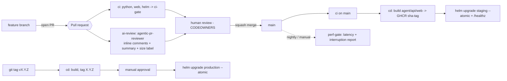

# CI/CD and pull-request flow

* **Pull request**: `ci.yml` (tests, web build, helm lint; `ci-gate` is the one required check) and `ai-review.yml`
  (your `agentic-pr-reviewer`, advisory: it comments and labels, it does not approve or block). Fork PRs and drafts skip the AI review
  because secrets are not available to them.
* **main**: green CI builds and publishes images, deploys to staging. **Tags `v*`** deploy to production after approval.
* Nightly `perf-gate` runs the real-WebRTC latency/interruption suite. Latency is advisory (`PERF_LATENCY_ADVISORY=1`) until the paid Groq tier.

## One-time GitHub setup
1. **Secrets** (Settings -> Secrets and variables -> Actions): `GROQ_API_KEY` (used by the AI review, the perf gate), and per environment `KUBECONFIG_B64`.
   Optional variable `REVIEW_MODEL` (default `openai/gpt-oss-120b`).
2. **Environments**: `staging`, `production` (add yourself as required reviewer on production). Variables `STAGING_API_URL`, `PRODUCTION_API_URL`.
3. **Branch protection on `main`** (Settings -> Branches -> Add rule): require a pull request, require 1 approval + code-owner review,
   require status check **`ci-gate`**, require branches up to date, block force-pushes.
4. Settings -> Actions -> General: workflow permissions "Read repository contents"; the workflows request what they need.
5. Packages: make the GHCR images public or add an image pull secret in the cluster.

Switching the reviewer to Gemini: in `ai-review.yml` use `provider: gemini` and `gemini_api_key: ${{ secrets.GEMINI_API_KEY }}`; remove the two `OPENAI_*` env lines.
Tune strictness in `.ai-reviewer.json` (`persona`: strict / balanced / lenient / security-only).
