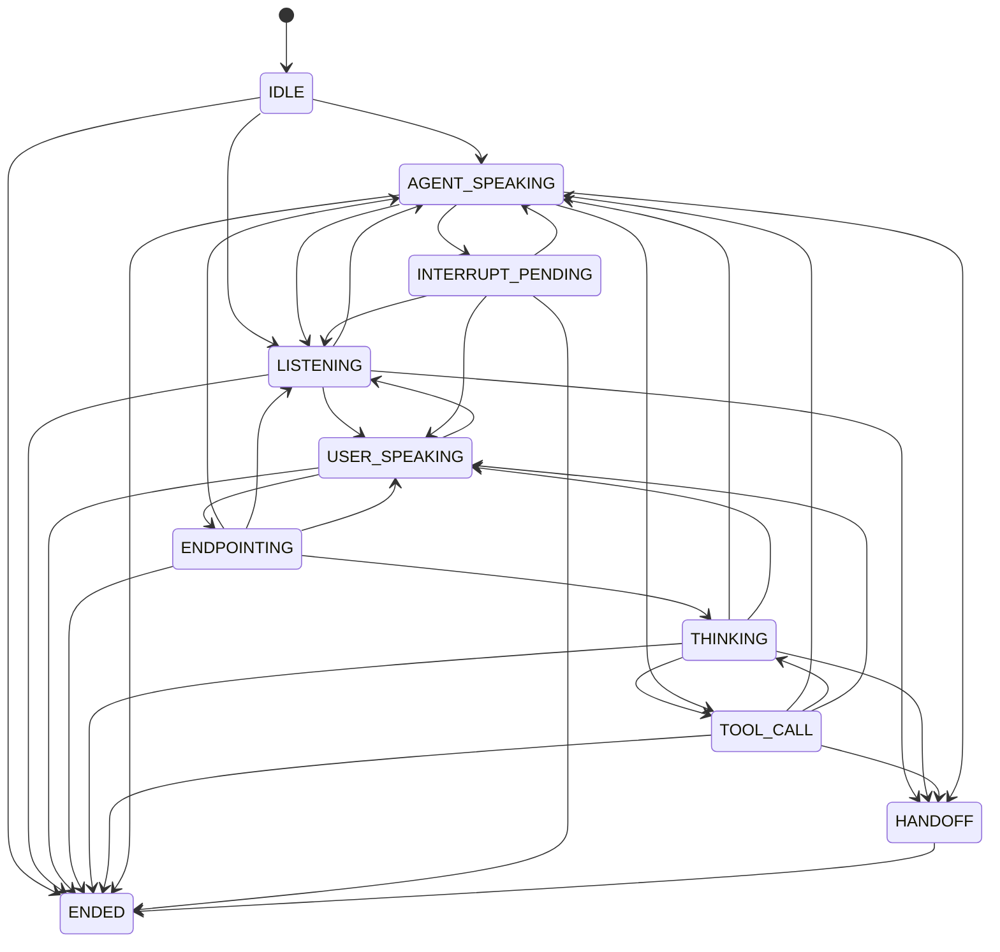

# Conversation state machine

Generated from `agent/voxa_agent/state.py` (`TRANSITIONS`); every edge is unit-tested and every
non-edge is tested to raise `IllegalTransition` (`tests/unit/test_state_machine.py`).

| Trigger | Transition |
|---|---|
| VAD speech start (agent silent) | LISTENING -> USER_SPEAKING |
| VAD speech end | USER_SPEAKING -> ENDPOINTING (preemptive LLM+TTS starts, audio held) |
| Endpoint wait elapsed + STT final | ENDPOINTING -> THINKING (held audio released) |
| First agent audio frame handed to WebRTC | THINKING -> AGENT_SPEAKING |
| VAD speech >= `stage1_min_speech_ms` while agent speaks | AGENT_SPEAKING -> INTERRUPT_PENDING (soft pause) |
| >= 2 content words or long speech | INTERRUPT_PENDING -> USER_SPEAKING (cancel + flush + truncate history) |
| cough / backchannel / own-voice echo | INTERRUPT_PENDING -> AGENT_SPEAKING (resume) |
| Audio fully played | AGENT_SPEAKING -> LISTENING |
| User resumes before/while reply starts | THINKING/ENDPOINTING -> USER_SPEAKING (cancel preemptive, merge text) |
